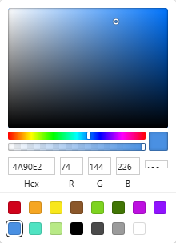

# ReactColorPicker

A colour picker Inputfield for ProcessWire with the thirteen pickers of
[react-color](https://github.com/casesandberg/react-color): Sketch, Chrome, Photoshop, Compact,
Circle, Twitter, Block, Github, Swatches, Material, Hue, Slider and Alpha. They are ported to plain
TypeScript and DOM, so no React and no jQuery reach the browser. A field downloads only the picker it
uses.

Works with any admin theme, and natively with the Bridge admin theme (AdminThemeBridge). It is not part
of Bridge and does not need it.



## Install

1. Put this folder in `site/modules/ReactColorPicker/` (copy, or a junction on a local machine).
   Sites need only the committed files; `node_modules/` is for building.
2. Modules > Refresh, install **Colour picker (react-color)** (`InputfieldReactColorPicker`).

## Use it on a page field

Create a **Text** field, and on its *Details* tab set **Input module** to *Colour picker
(react-color)*. Save, then on the *Input* tab pick a picker from the gallery: each picker is shown as a
screenshot, and only the chosen one runs live under the gallery.

Settings:

| Setting | Default | |
|---|---|---|
| `picker` | `sketch` | `sketch`, `chrome`, `photoshop`, `compact`, `circle`, `twitter`, `block`, `github`, `swatches`, `material`, `hue`, `slider`, `alpha` |
| `mode` | `popover` | `popover`: a swatch button opens the picker; `inline`: always open under the field |
| `alpha` | off | allow transparency (the Alpha picker always does) |
| `format` | `hex` | stored as `#rrggbb` (`#rrggbbaa` with transparency), `rgb()`/`rgba()` or `hsl()`/`hsla()` |
| `allowEmpty` | on | a clear button empties the field ("no colour") |
| `emptyLabel` | "Default" | what empty means, e.g. "Theme default" (shown in the field and on the clear button) |
| `emptyColor` | none | the colour empty stands for, shown struck through in the swatch and as the picker's start |
| `colors` | none | palette of the palette pickers, one colour per line; blank uses the picker's own |

The value is a plain string. Empty is `''`. Templates use it directly: `<div style="background: <?= $page->accent ?>">`.

## Use it in code (module config screens, forms)

```php
$f = $modules->get('InputfieldReactColorPicker');
$f->attr('name', 'accent');
$f->label = 'Accent';
$f->val('#ff6900');                // or '' for no colour
$f->picker = 'chrome';
$f->emptyLabel = 'Theme default';
$f->emptyColor = '#2563eb';        // what '' stands for
$inputfields->add($f);
```

`processInput()` stores the value in the field's format and refuses anything that is not a colour
(the old value stays, with an error). To check a value elsewhere:

```php
InputfieldReactColorPicker::normalize('#ABC');                  // '#aabbcc'
InputfieldReactColorPicker::normalize('rgba(255,0,0,.5)', 'hex', true); // '#ff000080'
InputfieldReactColorPicker::normalize('nope');                  // null
InputfieldReactColorPicker::normalize('');                      // ''
```

## In the browser

The field is a text input inside `<rcp-color-picker>`. The input keeps the value and the form posts it,
so the field works even without scripts. Each change sets the input's value and dispatches a bubbling
`input` event on it. Letting go (pointer up, a click, a typed value, the clear button) also dispatches
`change`. The element can be used without ProcessWire too:

```html
<script type="module" src="/site/modules/ReactColorPicker/assets/dist/rcp.js"></script>
<rcp-color-picker picker="twitter" allow-empty empty-label="Default" placeholder="#2563eb">
  <input type="text" name="accent" value="#ff6900">
</rcp-color-picker>
```

Attributes: `picker`, `mode` (`inline`), `alpha`, `format`, `allow-empty`, `empty-label`,
`placeholder` (the empty colour), `colors` (JSON array or comma list), `label`, `strings` (JSON of
translated UI text), `disabled`. Methods: `open()`, `close()`, `clear()`, `ready()` (resolves when the
picker is drawn); properties `value`, `state`.

Keyboard: the saturation square and the sliders are sliders (arrow keys, Shift for steps of ten,
Home/End), a palette is one tab stop with arrow keys, Escape closes the popover and returns focus.

## Content Security Policy

No `style` attributes, no inline scripts and no `innerHTML`: the pickers are styled by stylesheets
adopted into their shadow root, and positions and colours are set through the CSSOM. Checked under
BridgeCsp's report-only mode, which reports nothing from the picker. Colours follow Bridge's tokens
(`--popover`, `--border`, `--input`, `--ring` and so on) in light and dark. Without them, the pickers
keep react-color's light look. The Photoshop picker keeps its grey look in both schemes, as in
react-color.

## Build and checks

```bash
npm install
npm run build          # type check, vite build to assets/dist/, gzip budgets (scripts/check-size.mjs)
npm test               # colour model
PW=<playwright-core> npm run previews   # assets/previews/*.png for the settings gallery (--sheet: review sheets)
node scripts/serve.mjs 8095             # tests/demo.html: every picker, ?inline=1, &dark=1
```

On a Bridge sandbox (`<bridge>` is the Bridge repository, `<sandbox>` its `sandbox/<site>`):

```bash
php tests/sandbox-fixture.php <bridge> <sandbox>            # page /rcp-test/, prints RCP_ID, RCP_FIELD_ID
php tests/smoke.php <bridge> <sandbox>
BRIDGE=<bridge> BASE=http://localhost:8089 RCP_ID=.. RCP_FIELD_ID=.. PW=<playwright-core> node tests/browser-check.cjs
php tests/sandbox-fixture.php <bridge> <sandbox> --remove
```

## Licence

MIT. The pickers are ported from react-color 2.19.3, Copyright (c) 2015 Case Sandberg, MIT. The
colour conversions follow tinycolor2, and the default palettes are material-colors. See `LICENSE`.
